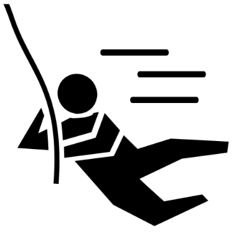

# Unstuck



**Get a Windows desktop working again when clicks stop doing anything.**

Sometimes Windows stops reacting to the mouse while the keyboard still works. A key or mouse button whose release
never arrived, a hung app holding mouse capture, a runaway process, a hung Explorer or a global mouse hook can each
cause it. Unstuck checks for every one of these in about three seconds and fixes what it finds, without restarting
the PC.

```text
RAM: 11840 MB free of 32581 MB
Keys held before: Left Shift
Keys still held:  none
Actions:
  release stuck mouse capture/buttons and modifier keys
  kill SomeApp (not responding) [pid 4120]
  restart DisplayFusion (its mouse hook can swallow every click)
No runaway process found.
```

## Install (one click)

1. Download **[Install-Unstuck.bat](https://github.com/mindattic/Unstuck/releases/latest/download/Install-Unstuck.bat)**.
2. Double-click it. If Windows SmartScreen warns about an unrecognized app, choose **More info → Run anyway**.

That's it. You don't need admin rights or .NET. It installs into `C:\Apps\Unstuck`, adds an **Unstuck** desktop
shortcut, and starts a small tray app that starts again every time you sign in.

**Whenever clicks stop working, press <kbd>Ctrl</kbd>+<kbd>Alt</kbd>+<kbd>Break</kbd> or <kbd>Ctrl</kbd>+<kbd>Alt</kbd>+<kbd>U</kbd>.**
Both work from any app, and there's nothing to set up.

Prefer PowerShell? This one line does the same:

```powershell
irm https://raw.githubusercontent.com/mindattic/Unstuck/main/setup/Install-Unstuck.ps1 | iex
```

To update, run the installer again. To remove Unstuck, use **Start menu → Unstuck → Uninstall Unstuck**.

## Without installing

Clone or download this repo, then:

| You want to… | Do this |
|---|---|
| **Unstick the desktop right now** | Double-click **`unstuck.bat`**, or run `unstuck.bat` in cmd. |
| See what it *would* do, changing nothing | `unstuck.bat check` |

If your mouse is dead, the keyboard still works: press <kbd>Win</kbd>+<kbd>R</kbd>, type the full path to
`unstuck.bat` and press <kbd>Enter</kbd>.

### Options

Options are plain words, and you can combine them (`unstuck.bat overlays explorer`):

| Option | What it adds |
|---|---|
| *(none)* | The default recovery, described below. |
| `check` | Report only. Lists what it would release, kill or restart, and changes nothing. |
| `explorer` | Restarts Explorer even if it looks healthy. |
| `hooks` | Also restarts PowerToys, because FancyZones, Always On Top and the mouse utilities hook the mouse. |
| `overlays` | Also closes overlay apps that can sit invisibly on top and swallow clicks: Overwolf, Steam, NVIDIA, Xbox Game Bar and Discord. |
| `all` | `overlays` + `explorer` + `hooks`. |
| `help` | Prints the full help. |

From PowerShell, the same options are switches: `.\unstuck.ps1 -Check`, `.\unstuck.ps1 -Overlays -Explorer`, and
`Get-Help .\unstuck.ps1 -Detailed` prints the help.

## What it does

1. **Releases stuck input.** It cancels any window's mouse capture and releases every mouse button. It releases
   both sides of Shift, Ctrl, Alt and Win, plus any other key Windows thinks is still held, and clears Sticky
   Keys latches. It clicks only when the left button is still reported down after its release, and never clicks
   the right button, so nothing gets pasted. Finally it moves the cursor a pixel so the pointer shape updates.
2. **Stops what has gone off the rails.** It kills apps still *Not Responding* after a 2-second re-check, a
   process using over 40% of RAM (or the biggest one when less than 5% of RAM is free), and a process using over
   70% of the CPU.
3. **Fixes the shell.** It restarts Explorer if it's hung or missing.
4. **Restarts DisplayFusion**, if it's running. Its global mouse hook is a known cause of clicks dying while the
   keyboard keeps working.
5. **Tells you what it can't fix.** For example, a gamepad trigger whose release never arrived has to be pressed
   and released on the controller.

It **never** kills Windows system processes, Explorer (it only restarts it), terminals, shells, editors, Claude,
Task Manager, or whatever launched it. It only acts on your own desktop session. See [How it works](docs/how-it-works.md)
for the details.

Every run's report is also saved to `%LOCALAPPDATA%\MindAttic\Unstuck\last-run.txt`, with past runs appended to
`history.log` in the same folder.

## `unstuck.ps1` vs `run.ps1`: which file is which?

| File | What it is | When you use it |
|---|---|---|
| **`unstuck.bat`** | A double-clickable wrapper for `unstuck.ps1`. | Whenever the desktop is stuck. |
| **`unstuck.ps1`** | **The recovery itself.** Everything above happens here. | Run it through `unstuck.bat`, the tray app or `/unstuck`. |
| **`setup/Install-Unstuck.bat`** | **The one-click installer** for everyone. It downloads the latest release; no build needed. | Once, and again to update. |
| **`install.bat`** | Builds and installs from source (a wrapper for `run.ps1`). Developers only: needs the .NET 10 SDK. | After changing the code. |
| **`run.ps1`** | **The source installer.** It copies `unstuck.ps1` to `C:\Apps\Unstuck\` and builds the tray app there. It doesn't fix anything itself. | Through `install.bat`, or the `/deploy` command. Every MindAttic repo uses the name `run.ps1` for its deploy script. |

In short: **`unstuck` fixes, `install`/`run` installs.**

After installing, `C:\Apps\Unstuck\` contains:

- `unstuck.ps1`: the installed copy of the recovery.
- `UnstuckTaskbar.exe`: the tray app.
- `unstuck.bat`, which the **Unstuck** desktop shortcut runs (one-click install).
- `run.bat`, from a source install only: a launcher menu with two choices, *1) Deploy & Run* (update from this repo,
  then recover) and *2) Run* (recover now).

## Other ways to run it

- **Tray app and global hotkeys.** `UnstuckTaskbar.exe` sits in the notification area and runs the recovery when
  you press <kbd>Ctrl</kbd>+<kbd>Alt</kbd>+<kbd>Break</kbd>, <kbd>Ctrl</kbd>+<kbd>Alt</kbd>+<kbd>U</kbd>, or double-click the icon. Its menu also has *Check only*, *Restart Explorer* and the other
  options, plus the last report, plus setting your own extra hotkey straight from the menu. See [Tray app](docs/tray-app.md).
- **Claude Code.** `/unstuck`, `/unstuck check`, `/unstuck hooks`, `/unstuck overlays` and `/unstuck explorer`
  run the same script and summarize the result. The command is defined in [`commands/unstuck.md`](commands/unstuck.md).

## Still stuck?

Try these in order: `unstuck.bat hooks`, then `unstuck.bat overlays`, then `unstuck.bat explorer`, then
<kbd>Ctrl</kbd>+<kbd>Shift</kbd>+<kbd>Esc</kbd> (Task Manager) or <kbd>Ctrl</kbd>+<kbd>Alt</kbd>+<kbd>Del</kbd>, which
breaks a full-screen app's hold on input. [Troubleshooting](docs/troubleshooting.md) covers specific symptoms.

## Requirements

- Windows 10 or 11 with Windows PowerShell 5.1, which every Windows install already has.
- For the tray app only: the [.NET 10 SDK](https://dotnet.microsoft.com/download) to build it, and the MindAttic
  NuGet packages (`MindAttic.Vault`, `MindAttic.Components.Wpf`), which resolve from `C:\LocalNuGet` (see
  `NuGet.config`).

Admin rights aren't needed. Run elevated, it still only touches your own session.

## Repository layout

```text
unstuck.ps1            the recovery script
unstuck.bat            double-click launcher for it
setup/                 one-click installer (Install-Unstuck.bat/.ps1) and release packaging
run.ps1 / install.bat  build-from-source installer: C:\Apps\Unstuck + tray app
commands/unstuck.md    the /unstuck Claude Code command
UnstuckTaskbar/        tray app (WPF, .NET 10): hotkey, menu, balloon summaries
UnstuckTaskbar.Tests/  NUnit tests for the tray app
docs/                  articles published to the GitHub Pages site
```

## Documentation

The site at **<https://mindattic.github.io/Unstuck/>** is built from this README and [`docs/`](docs/) on every push
to `main`:

- [How it works](docs/how-it-works.md): each step in detail, and what is never touched.
- [Tray app](docs/tray-app.md): install, hotkey, menu and settings.
- [Troubleshooting](docs/troubleshooting.md): what to try for each symptom.
